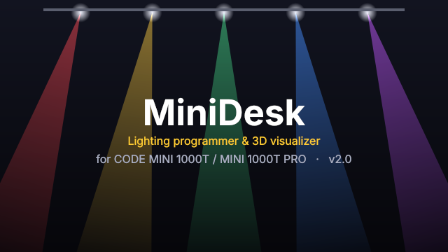
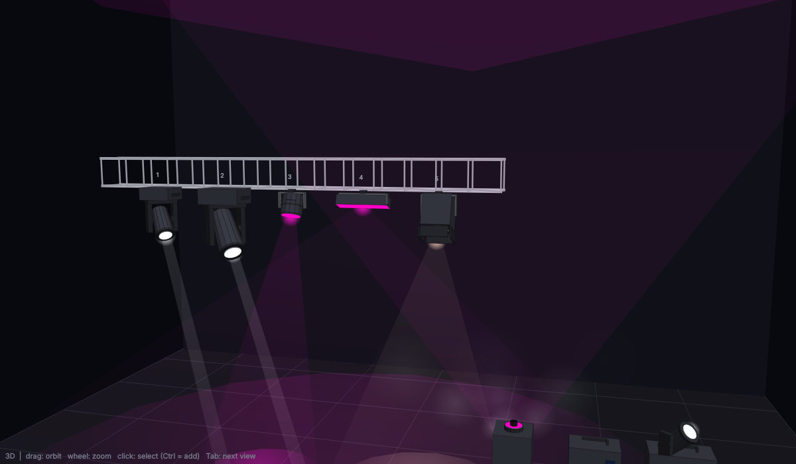
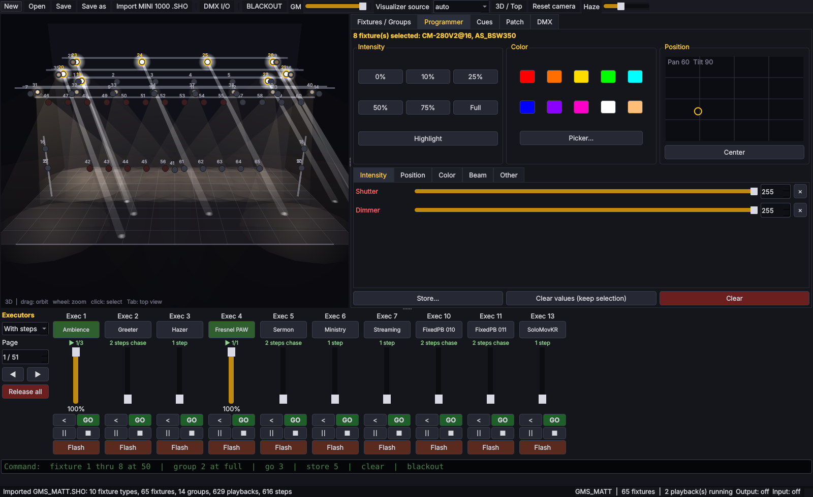
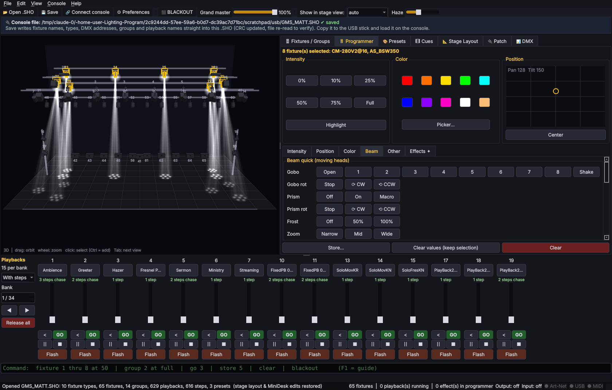
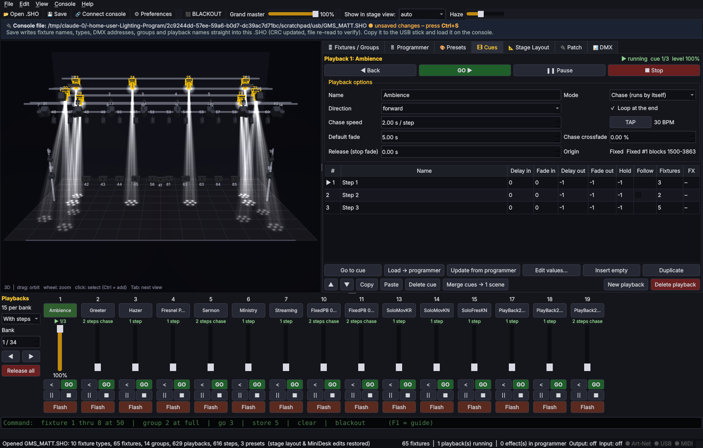
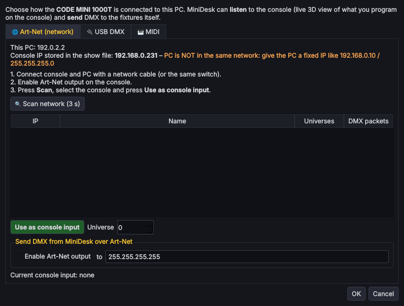
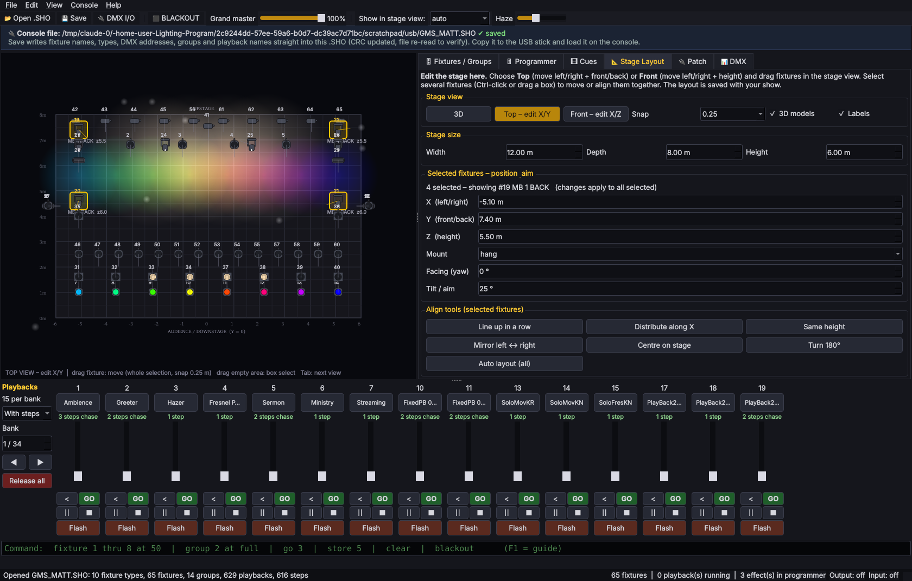
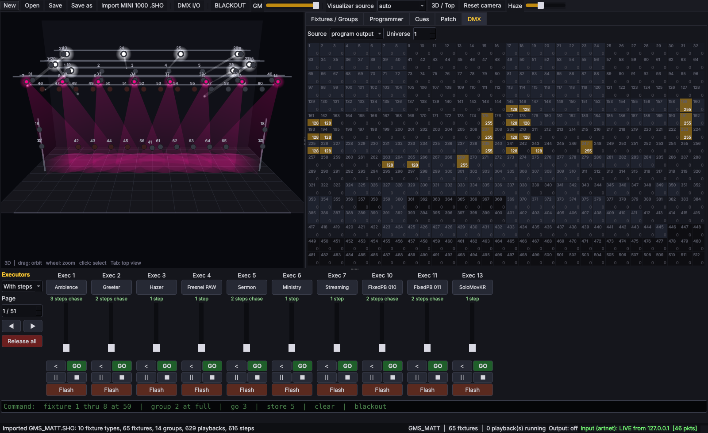

# MiniDesk – Lighting programmer & visualizer untuk CODE MINI 1000T / MINI 1000T PRO

Aplikasi Python (PySide6/Qt) untuk **programming lighting** dengan gaya *dot2 onPC* / *QLC+*,
dilengkapi **visualizer 3D** sehingga Anda bisa melihat apa yang sedang di-setting dan bagaimana
playback berjalan – dan **kompatibel dengan console CODE MINI 1000T / MINI 1000T PRO**:

| Fitur kompatibilitas | Keterangan |
|---|---|
| **Buka & simpan langsung file show console (`*.SHO`)** | Edit lalu **Save (Ctrl+S)** → ditulis kembali ke file `.SHO` yang sama (CRC header dihitung ulang, file dibaca ulang untuk verifikasi). Salin ke USB, colok ke console, load, mainkan. |
| Isi file yang dibaca | Library fixture, patch DMX (4 universe), tipe tiap fixture, group (nama + anggota + urutan), playback & fixed playback beserta step/cue-nya, IP console |
| Isi preset console | Preset color/position/beam dari file console ikut terbaca (yang datanya utuh) |
| Visualizer live dari console | DMX dari console via **Art-Net** atau interface **USB DMX (ENTTEC Pro) mode input** |
| Output ke lampu | Art-Net, sACN (E1.31), ENTTEC DMX USB Pro, Open DMX (kabel FTDI) |
| **Plug & play** | *Console → Connect console (Ctrl+K)*: scan Art-Net (ArtPoll), cek IP PC vs console, deteksi otomatis interface USB DMX + sambung ulang otomatis saat dicolok, **MIDI in/out + MIDI Learn** (Windows: tanpa install tambahan) |

















## Apa yang disimpan ke file console (.SHO)

| Bisa diubah di MiniDesk dan **ditulis ke .SHO** | Hanya di MiniDesk (format console tidak punya tempatnya) |
|---|---|
| Nama fixture, tipe fixture (dari library console), universe & address, patch/unpatch | Posisi di panggung (Stage Layout), model 3D |
| Tambah fixture baru (tipe dari library console) | Effect, perubahan isi/timing cue |
| Group: buat, ganti nama, ubah anggota & urutan, hapus | Playback baru yang dibuat di MiniDesk |
| Nama playback & fixed playback, nama preset | Pengaturan visual tipe fixture, fungsi channel |
| Tabel kepemilikan channel DMX console + CRC header | |

- Simpan tanpa perubahan menghasilkan file **identik byte-per-byte** dengan aslinya; hanya byte
  yang Anda ubah yang berubah, sisanya (cue, preset, setting console) tetap utuh.
- Sebelum menulis, MiniDesk menolak penyimpanan bila ada address bertabrakan, fixture melewati
  batas universe, atau tipe fixture yang tidak ada di library console – file lama tidak disentuh.
- Setiap Save membuat **backup** file sebelumnya di `~/.minidesk/backups/`.
- Menghapus fixture yang berasal dari console tidak didukung (cue di console bisa memakainya) –
  gunakan **Unpatch**.
- Data "hanya di MiniDesk" disimpan otomatis di `~/.minidesk/projects/` dan muncul lagi saat file
  `.SHO` yang sama dibuka (USB tetap hanya berisi file console). Atau simpan sebagai project
  `.mdshow` lewat *File → Export MiniDesk project*.

> ⚠️ Format `.SHO` dibaca dari file show asli (tidak ada dokumentasi resmi). Penulisan sudah diuji
> (round-trip byte-identik, verifikasi CRC, import ulang), tetapi **belum diuji langsung di console**.
> Uji dulu di console dengan salinan file, dan simpan backup show asli Anda.

## Fitur

- **Visualizer 3D** dengan **model 3D per tipe fixture** (low-poly, dibuat khusus untuk MiniDesk):
  moving head *beam / hybrid / spot / wash* (base, yoke dan head ikut pan/tilt, beam keluar dari
  lensa), LED PAR, fresnel dengan barn door, strobe bar, LED bar, blinder, hazer, fog machine dan
  fog vertikal dengan LED (dengan asap), plus **box truss & tower** otomatis. Model dipilih otomatis
  dari nama fixture (CM-280 → beam, AS_BSW350 → hybrid, CLED-543/PAR → LED PAR, DSK-1500VS → fog
  vertikal, …) dan bisa diganti / **di-import sendiri (OBJ, GLB/glTF, STL)** dengan preview 3D di
  *Patch → Edit fixture type & 3D model*. Lihat [`docs/MODELS.md`](docs/MODELS.md).
- **Stage Layout** (tab khusus): ukuran panggung, view **Top** (geser kiri/kanan + depan/belakang)
  dan **Front** (geser kiri/kanan + tinggi), drag fixture dengan snap grid, pilih banyak (Ctrl+klik
  atau tarik kotak), form X/Y/Z, mount, arah (yaw) dan tilt, tombol *Line up*, *Distribute*,
  *Same height*, *Mirror*, *Centre*, *Turn 180°*, *Auto layout*.
- **Beam moving head** (Programmer → *Beam*): tombol cepat gobo (Open, 1–8, shake), gobo rotation
  (stop / CW / CCW), prism (off / on / macro), prism rotation, frost (0/50/100 %), zoom, focus, iris,
  shutter (open / strobe / closed), lamp on / reset. Setiap channel punya **daftar fungsi** (rentang DMX)
  – bisa dipilih dari dropdown di programmer dan diedit di *Patch → Edit fixture type → Functions*.
  Visualizer menampilkan **gobo** (pola berputar di lantai & sinar bertekstur), **prism** (sinar terpecah
  dan berputar), **frost** (sinar lebar & lembut), zoom dan iris.
- **Presets** (tab 🎨): simpan programmer sebagai preset *Color / Position / Beam / Intensity / All*,
  klik untuk memakai ke fixture terpilih (fixture tipe sama ikut mendapat nilai), klik kanan untuk
  rename / update / kategori / hapus. Preset dari console ikut terbaca.
- **Effects** (Programmer → *Effects ✦*):
  - Position: circle, figure 8, pan wave, tilt wave, ballyhoo
  - Intensity: dimmer sine, pulse/ramp, chase, random, strobe
  - Color: rainbow, color chase (2 warna)
  - Parameter: speed (Hz/BPM), size, low/high, phase spread, phase offset, wings (mirror),
    duty, fade-in effect, reverse. Effect bisa disimpan ke cue dan ikut fader playback.
- **Timing cue**: delay in, fade in, delay out, fade out (untuk intensitas turun), hold, **follow**
  (cue berikutnya jalan otomatis).
- **Playback lengkap** (tab 🎞 Cues): mode chase / cue list, arah **forward / backward / bounce /
  random**, loop on/off, speed + **TAP tempo** (BPM), crossfade % untuk chase, **release** (fade saat
  stop), transport GO / back / pause / stop, tabel cue dengan *Edit values*, *Update from programmer*,
  *Insert*, *Duplicate*, *Copy / Paste*, urutkan, *Merge → 1 scene*.
- **Playbacks**: **15 playback per bank** (bisa 10/12/15/20 di Preferences), fader, GO, back, pause,
  stop, Flash, klik kanan untuk TAP / speed ×2 ÷2; intensitas **HTP**, atribut lain **LTP**;
  Grand Master & Blackout.
- **Fixtures / Groups**: tile fixture dengan ikon model & warna live; klik kanan group untuk
  rename / update anggota / hapus.
- **Programmer**: fader per atribut, intensitas cepat, Highlight, color picker, XY pad pan/tilt.
- **Patch**: tabel + form fixture (nama, tipe, universe, address, *Next free address*, *Unpatch*),
  **Re-address selected** (banyak fixture sekaligus dengan cek tabrakan address).
- **Splash screen**, layar pembuka, **Preferences** (playback per bank, fade default, autosave project,
  haze, model 3D, label), lampu status koneksi (Art-Net / USB / MIDI) di status bar.
- **DMX monitor** dan **command line gaya dot2**:

```
fixture 1 thru 8 at 50      f 1 + 3 + 5 at full      group 7 at 75      pan 128
go 3      back 3      off 3      goto 3 2      store 5      store 5 /merge
clear     blackout    highlight
```

- Menu **Help → Quick guide (F1)** berisi panduan singkat berbahasa Indonesia.

## Instalasi

> MIDI di Windows langsung bekerja (WinMM bawaan Windows). Di Linux/macOS tambahkan
> `pip install python-rtmidi` bila perlu MIDI.


Butuh Python 3.10 atau lebih baru (Windows / macOS / Linux).

```bash
pip install -r requirements.txt
```

### Windows: error "Long Path" / `No such file or directory ... PySide6\qml\...`

Python dari Microsoft Store menyimpan paket di folder yang sangat panjang, sehingga instalasi
PySide6 gagal karena batas 260 karakter Windows. Solusi termudah: pakai virtual environment di
folder pendek (jalankan di PowerShell, di folder proyek):

```powershell
python -m venv C:\venv\minidesk
C:\venv\minidesk\Scripts\python -m pip install -r requirements.txt
C:\venv\minidesk\Scripts\python -m minidesk samples\GMS_MATT.SHO
```

`run_windows.bat` otomatis memakai `C:\venv\minidesk` bila ada.
Alternatif: aktifkan Long Path Support (PowerShell *Run as Administrator*), lalu buka ulang terminal:

```powershell
New-ItemProperty -Path "HKLM:\SYSTEM\CurrentControlSet\Control\FileSystem" -Name LongPathsEnabled -Value 1 -PropertyType DWORD -Force
```

## Menjalankan

```bash
python -m minidesk
```

Langsung membuka file console:

```bash
python -m minidesk samples/GMS_MATT.SHO
```

Windows: klik dua kali `run_windows.bat`. Linux/macOS: `./run.sh`.

## Alur kerja dengan console CODE MINI 1000T

### 0. Sambungkan console (plug & play)

*Console → Connect console* (Ctrl+K) atau tombol **🔗 Connect console**:

| Koneksi | Langkah |
|---|---|
| **Art-Net** (kabel LAN) | PC & console satu jaringan (wizard memberi tahu bila IP PC belum cocok, mis. set PC ke `192.168.0.10`), aktifkan Art-Net di console, tekan **Scan**, pilih console → *Use as console input*. |
| **DMX** (USB-DMX) | Colokkan interface; wizard menampilkannya. DMX OUT console → DMX IN ENTTEC USB Pro → *Use as console input*. Untuk menyalakan lampu dari PC: *Use as output (USB Pro / Open DMX)*. Interface yang dicabut/dicolok lagi tersambung otomatis. |
| **MIDI** | Pilih MIDI in/out, lalu **Learn**: pilih aksi (GO, fader, flash, stop, GM, blackout, bank) → tekan tombol / gerakkan fader di console. *Auto map* = note 0–14 → GO, CC 0–14 → fader bank 1. MIDI out mengirim note saat playback di-GO. |

### A. Lihat apa yang sedang diprogram di console (visualizer live)

1. Simpan show di console, salin file `.SHO` ke PC, lalu **Import MINI 1000 .SHO** (Ctrl+I).
   Fixture, patch, group dan playback langsung muncul; posisi fixture diatur otomatis dari nama
   group (DEPAN/FRONT, BELAKANG/BACK, TENGAH, ATAS/TOP, TOWER, …) – geser di *Top view* bila perlu,
   lalu **Save** sebagai `.mdshow`.
2. Hubungkan PC dan console ke jaringan yang sama (mis. PC `192.168.0.10`, subnet `255.255.255.0`;
   console di file contoh memakai `192.168.0.231`) dan aktifkan output Art-Net di console.
   Alternatif tanpa jaringan: sambungkan output DMX console ke interface ENTTEC DMX USB Pro
   (mode receive).
3. Buka **DMX I/O…** → *Input mode* = `artnet` (universe 0) atau `enttec` + port USB.
4. *Visualizer source* = `auto`: begitu data console masuk, status bar menampilkan
   **LIVE from &lt;IP console&gt;** dan visualizer mengikuti apa pun yang Anda mainkan di console.
   Pilih `mix (HTP)` untuk menggabungkan console + programmer PC.

### B. Edit file console lalu pakai di console

1. **File → Open console file (.SHO)** (langsung dari flashdisk boleh).
2. Ubah patch/nama di tab **Patch**, group di **Fixtures / Groups**, nama playback di **Cues**.
3. **Ctrl+S** → muncul laporan apa saja yang ditulis + hasil verifikasi.
4. Cabut flashdisk (*Safely remove*), colok ke console, load show.

### C. Programming / pre-programming di PC

1. Pilih fixture/group → atur di **Programmer** (atau ketik di command line).
2. **Store…** ke executor (step baru, merge, atau overwrite).
3. Mainkan lewat **Executor bar**; edit timing di tab **Cues**.
4. Bila ingin menyalakan lampu langsung dari PC, aktifkan Art-Net / sACN / USB Pro di **DMX I/O…**.
   Jangan mengirim ke lampu yang sama bersamaan dengan console kecuali jaringan Anda melakukan merge.

## Catatan kompatibilitas `.SHO`

Format `.SHO` MINI 1000 tidak dipublikasikan; struktur dibaca dari file show asli
(lihat [`docs/FORMAT_SHO.md`](docs/FORMAT_SHO.md)).

- **Sudah andal**: library fixture & nama channel, patch/alamat DMX, tipe tiap fixture, group,
  nama playback & fixed playback, IP console.
- **Beta**: isi step playback (nilai per channel) dan waktu fade/speed. Isi step di-decode dari
  "block heap" internal console, jadi beberapa playback bisa kosong atau berisi step sisa (stale).
  Bandingkan cue penting dengan console lewat input Art-Net, lalu perbaiki di tab **Cues**
  (mis. *Merge steps → 1 scene* bila step ternyata bagian dari satu scene).
- Warna color wheel & perilaku shutter di visualizer adalah pendekatan generik; sesuaikan atribut
  channel di **Patch → Edit fixture type…** bila perlu.
- Export balik ke format `.SHO` belum didukung (sengaja, agar file console tidak rusak).

## Struktur proyek

```
minidesk/
  sho_import.py   importer file show CODE MINI 1000T (.SHO)
  model.py        model show (fixture type, patch, group, playback, step) + simpan/buka JSON
  engine.py       engine DMX: programmer, playback/chase, fade, HTP/LTP, GM, blackout
  dmx_io.py       Art-Net / sACN / ENTTEC USB Pro output + Art-Net / USB Pro input
  commands.py     command line gaya dot2
  vis_state.py    DMX -> intensitas, warna, arah beam (dipakai visualizer)
  layout.py       auto layout posisi fixture dari nama group
  ui/             jendela utama, visualizer, programmer, executor, cue editor, patch, DMX monitor
samples/GMS_MATT.SHO   contoh show dari console
tests/                 unit test (pytest)
```

## Test

```bash
pip install pytest
python -m pytest -q
```
